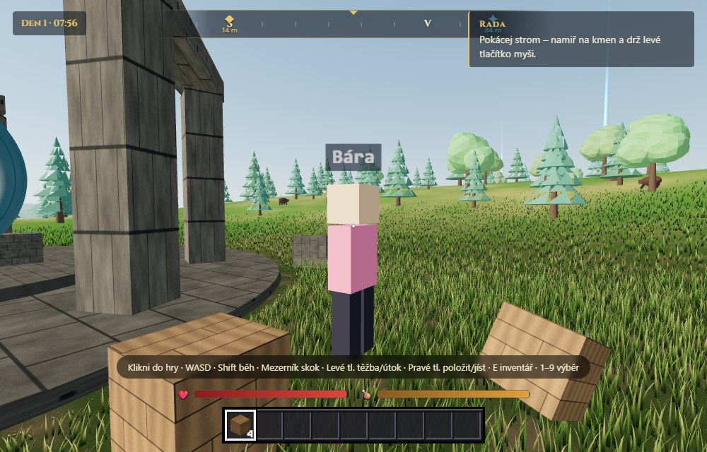

# Říše (Louka)

Survival hra v prohlížeči pro celý kroužek: kácej stromy, těž kámen a železo, vyráběj nástroje,
stav, peč maso u táboráku a přežij noc se *stínožrouty*. Spolu ve **stejném světě**, který tu je i příští týden.



## Jak hrát

1. Otevři odkaz hry (od Richarda).
2. Napiš své **jméno** a **heslo kroužku** → **Hrát spolu**. (Bez internetu: **Hrát sám**.)
3. Klikni do hry.

| Ovládání | |
|---|---|
| W A S D | chůze, **Shift** běh, **mezerník** skok |
| myš | rozhlížení |
| levé tlačítko (drž) | kácet, těžit, sekat trávu, útočit |
| pravé tlačítko | položit blok, jíst, otevřít pracovní stůl / táborák |
| E | inventář a výroba (Esc zavře) |
| 1–9, kolečko | výběr v hotbaru |
| Tab | kdo je ve hře |

Když vypadne internet, hra napíše *„Spojení ztraceno — připojuji znovu…“* a připojí se sama.
Se stejným jménem máš zpátky svůj batoh i místo, kde jsi stál(a).

## Spustit u sebe

Potřebuješ [Node.js](https://nodejs.org) 20 nebo novější.
```bash
npm install
npm run dev
```
Otevři **http://localhost:5173**. `npm run dev` pustí hru i herní server najednou.
Ještě jednodušší: na GitHubu **Code → Codespaces → Create codespace** (vše je připravené).

```bash
npm test             # rychlé testy
npm run build        # sestavení hry do client/dist
npm run playtest     # hra si sama zahraje 60 kontrol v prohlížeči
```

## Uspořádat hru pro kroužek

- **VPS (hlavní cesta):** jeden příkaz, viz [docs/HOSTING.md](docs/HOSTING.md).
- **Notebook + Cloudflare Tunnel (záloha):** `ROOM_PASSWORD=heslo npm start` a `cloudflared tunnel --url http://localhost:8787`,
  podrobně v [docs/HOSTING.md](docs/HOSTING.md).

## Pro tvůrce

- [CONTRIBUTING.md](CONTRIBUTING.md): jak přidat něco do hry (větev → změna → pull request).
- [AGENTS.md](AGENTS.md): jak je hra postavená a pravidla pro AI pomocníky; návody „jak přidat předmět / blok / recept / tvora“.
- [docs/V1-BRIEF.md](docs/V1-BRIEF.md): co má umět verze 1.

Postaveno na prototypu [aimartinmarek-afk/louka](https://github.com/aimartinmarek-afk/louka) (Three.js, Vite, Node.js, ws).
